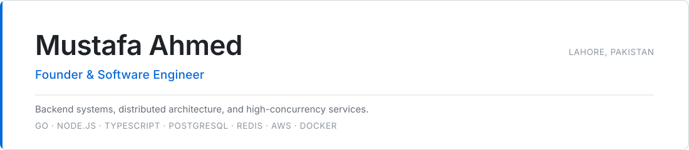

## About

I build backend systems that stay up. My work centres on Go — high-concurrency
services, worker pools, and event-driven pipelines — backed by PostgreSQL, Redis,
and AWS. I care about clean architecture, production readiness, and code the next
engineer can read without a walkthrough.

Founder and engineer: I own the work end to end, from architecture and API design
through deployment and the on-call that follows.

**Based in Lahore, Pakistan · open to remote and relocation.**

## Selected Work

| Project | Stack | Summary |
|:---|:---|:---|
| **[Scalable Sports Backend](https://github.com/musishere)** | Go · AWS SQS · PostgreSQL · Docker | High-concurrency service built on worker pools, channel pipelines, and event-driven SQS message processing. |
| **[Real-Time Chat Platform](https://github.com/musishere)** | Node.js · Socket.IO · React | Multi-room messaging with live presence, private channels, and WebSocket concurrency handling. |
| **[E-Commerce Platform](https://github.com/musishere)** | Node.js · MongoDB · React | Full-stack storefront: product management, cart, JWT auth, and MVC-structured REST APIs. |
| **[Learning Management System](https://github.com/musishere)** | Node.js · PostgreSQL | Modular course platform with enrollment tracking and layered API validation. |

## Stack

| Area | Tools |
|:---|:---|
| Languages | Go, TypeScript, JavaScript |
| Go frameworks | Gin, Fiber |
| Node ecosystem | Express, Socket.IO, React |
| Databases | PostgreSQL, MongoDB, MySQL |
| Cache & queues | Redis, AWS SQS |
| Cloud & delivery | AWS, Docker, Git |
| Practices | REST API design, clean architecture, microservices, WebSockets, JWT |

## Currently

- Building high-concurrency Go services and event-driven architectures
- Deepening distributed systems work: queues, worker pools, observability
- Open to founding-engineer and senior backend roles, and to collaboration

## Activity

## Contact

Best reached by [email](mailto:mustafabukhari333@gmail.com) or on
[LinkedIn](https://www.linkedin.com/in/mustafa-ahmed-012675279/). Happy to talk
about backend architecture, Go, or work you need shipped.
