<picture>
  <source media="(prefers-color-scheme: dark)" srcset="./assets/hero.svg" />
  
</picture>

AI agent & backend engineer. I build production AI agents and the infrastructure that keeps them secure, metered and auditable.

Lahore, PK · Remote (GMT+5) · Open to remote AI / backend roles

 

 

### Projects

<a href="https://github.com/musishere/Warden-tickmark">
  <picture>
    <source media="(prefers-color-scheme: dark)" srcset="./assets/warden.svg" />
    
  </picture>
</a>

An MCP gateway that enforces per-call authorization, ethical walls and an append-only audit trail for AI agents at audit, law and consulting firms.

Works with unmodified Claude Code and VS Code, and tools an agent shouldn't use are never exposed, so a prompt-injected call to one just returns `unknown tool`.

<b>More on Warden</b>

 

Audit, law and consulting firms want staff using AI agents on client work, but an agent can be steered by a document it reads, can wander into a client it shouldn't see, and leaves no record. Warden sits in front of the MCP tool servers and checks each call, not just the sign-in.

- Agents connect by pointing their tool-server URL at Warden. Claude Code, VS Code and MCP Inspector work unmodified.
- The user signs in with Entra ID. The agent gets a 15-minute pass scoped to one engagement and capped at what that user can do.
- Seven checks run on every call against current data, so removing someone from an engagement takes effect on the next call.
- Ethical walls apply to the person and all their agents, Admin included.
- Tools an agent shouldn't use are left off its tool list entirely, so a prompt-injected `export_documents` gets `unknown tool`.
- Tool servers only accept Warden's one-minute, single-tool tokens and have no public address in Azure.
- The audit table is append-only at the database level: Postgres rejects updates and deletes.
- A SCIM deprovision revokes every pass the user's agents hold in one transaction.

The repo also has Tickmark, an agent that vouches an Excel sample against invoice PDFs. The model extracts, plain code decides the match. It runs behind Warden as the demo.

 

<a href="https://github.com/musishere/AI-platform-engineering/tree/main/llm-gateway">
  <picture>
    <source media="(prefers-color-scheme: dark)" srcset="./assets/gateway.svg" />
    
  </picture>
</a>

A multi-tenant proxy in front of the Claude API with hashed keys, per-call usage metering and Redis rate limits.

Fixed a concurrency race with reserve-then-settle accounting in Redis Lua: 20 concurrent requests with 100 tokens left → 4 admitted, 0 overshoot.

<b>More on the gateway</b>

 

A FastAPI proxy in front of the Claude API, built a layer at a time. The official Anthropic SDK talks to it without changes. Tenant keys are stored hashed, and every call writes a usage row with tokens, cost, latency and outcome.

- Streaming responses are relayed as SSE while token counts are read from the events. Clients that disconnected mid-stream used to get the output for free; those rows now get an estimate and a `client_disconnected` label.
- Rate limits are a per-tenant token bucket plus a monthly quota, both atomic Lua scripts in Redis. The first version checked then wrote, and 20 concurrent requests all read the same stale count. Switching to reserve-then-settle (like a hotel card hold) fixed it: with 100 tokens left, 4 of 20 get in and the quota doesn't go over.
- Infra is Terraform on Oracle Cloud (versioned remote state, budget alerts, VCN, OKE). Free ARM capacity ran out, so it currently deploys via Argo CD to a local cluster; moving to OKE is a cluster target change.

Next up: canary releases, SLOs with burn-rate alerts, then a self-hosted model on vLLM with cost-aware routing.

 

<a href="https://khel-landing.pages.dev/">
  <picture>
    <source media="(prefers-color-scheme: dark)" srcset="./assets/khel.svg" />
    
  </picture>
</a>

A turf-booking marketplace I co-founded, where I own the Go backend ([khel-landing.pages.dev](https://khel-landing.pages.dev/)).

Built peer-to-peer split payments in-house instead of using a third-party gateway, which cut transaction costs and removed an external dependency.

<b>More on Khel</b>

 

Turf-booking marketplace I co-founded. I own the backend, written in Go.

- Reservation engine that handles slot conflicts, payment deadlines and partial payments. This is the part that decides whether a booking turns into revenue.
- Peer-to-peer split payments built in-house instead of going through a third-party gateway, which cut transaction costs.
- ELO ratings updated from match results, used for skill-based matchmaking.
- Badges and streaks for retention.

 

### Stack

  <picture>
    <source media="(prefers-color-scheme: dark)" srcset="https://skillicons.dev/icons?i=rust,go,py,dotnet,ts&theme=dark" />
    
  </picture>  
  <picture>
    <source media="(prefers-color-scheme: dark)" srcset="https://skillicons.dev/icons?i=fastapi,nodejs,nestjs,postgres,redis,react&theme=dark" />
    
  </picture>  
  <picture>
    <source media="(prefers-color-scheme: dark)" srcset="https://skillicons.dev/icons?i=aws,azure,docker,kubernetes,terraform,linux&theme=dark" />
    
  </picture>

Also: Claude API, MCP, LangGraph, RAG with pgvector, evals, prompt-injection testing

 

<picture>
  <source media="(prefers-color-scheme: dark)" srcset="./assets/now.svg" />
  
</picture>

  

<picture>
  <source media="(prefers-color-scheme: dark)" srcset="https://raw.githubusercontent.com/musishere/musishere/output/github-snake-dark.svg" />
  
</picture>

BSc Computer Science, University of Lahore · <a href="mailto:mustafabukhari333@gmail.com">mustafabukhari333@gmail.com</a>

